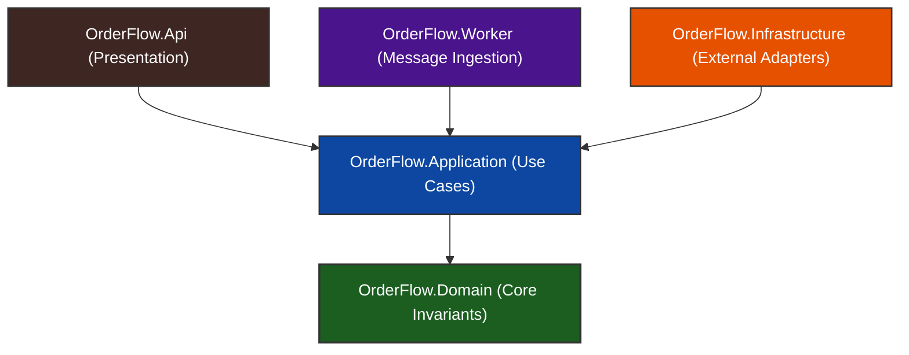
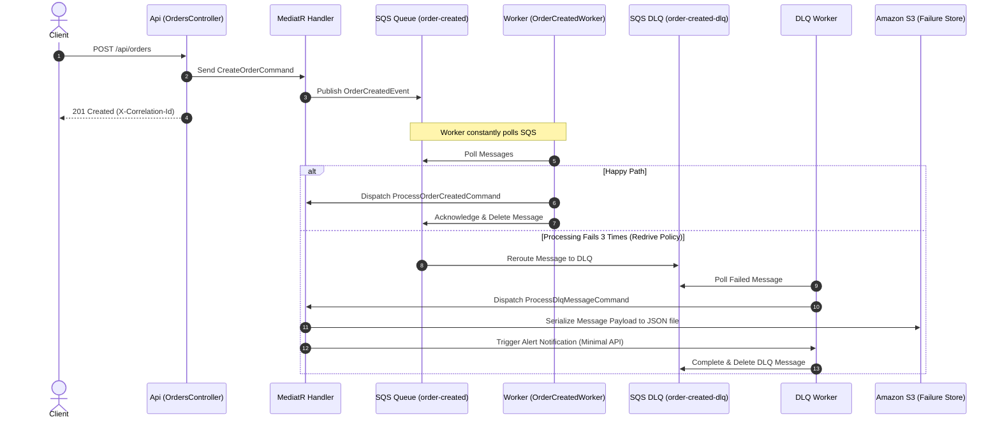

# OrderFlow 🧾


[](https://sonarcloud.io/summary/new_code?id=KSIECIUNI0_orderflow-backend)
[](https://sonarcloud.io/summary/new_code?id=KSIECIUNI0_orderflow-backend)
[](https://sonarcloud.io/summary/new_code?id=KSIECIUNI0_orderflow-backend)
[](https://sonarcloud.io/summary/new_code?id=KSIECIUNI0_orderflow-backend)

**OrderFlow** is a cloud-native order processing backend designed to demonstrate enterprise-level .NET architectural patterns. It features an event-driven messaging pipeline, distributed tracing, a resilient failure-recovery store, and high-fidelity integration testing.

---

## 🏛️ Architecture & Core Design Patterns

The system is built on **Clean Architecture** and **CQRS (Command Query Responsibility Segregation)** principles, ensuring a separation of concerns and high testability.



### 🧠 Strategic Choices
*   **Domain-Driven Design (DDD)**: Core business rules are encapsulated within the domain layer. The `Order` aggregate guards its invariants (e.g., product length validation and positive quantity constraints) and prevents invalid state initialization.
*   **CQRS with MediatR**: Segregates write operations (Commands like `CreateOrderCommand`) from read operations (Queries like `GetOrderByIdQuery`). Handlers remain decoupled, thin, and single-purpose.
*   **Decoupled Interfaces**: External resources like message publishers, database contexts, and object storage are abstracted in the Application layer and implemented in the Infrastructure layer, keeping the core code framework-agnostic.

---

## ⚡ Asynchronous Pipeline & Resiliency (SQS & S3 DLQ)

OrderFlow implements an asynchronous processing topology designed to guarantee event processing and failure containment using **AWS SQS** and **AWS S3** (stubbed locally via **LocalStack**):



### 🛠️ Failure Recovery & Message Replay
When a message lands in S3 after a DLQ failure, it is marked as a "Failed Message" and remains queryable. Through the **Failed Messages API**:
1.  Administrators can query paginated failures directly from S3.
2.  A `/resend` endpoint triggers the **ResendFailedMessageCommand** which reads the payload from S3, republishes the message to the main SQS queue, and cleans up the S3 file once safely republished.

---

## 🔍 Distributed Tracing & Observability

To trace execution flows across HTTP APIs, message queues, and background services, the system implements distributed tracing using **Correlation IDs**:

*   **HTTP Entry**: The `CorrelationIdMiddleware` captures or generates a transaction ID (`X-Correlation-Id`) and sets it in the scoped `ICorrelationIdAccessor`.
*   **Log Contextualization**: Serilog pushes the Correlation ID to the `LogContext`, automatically attaching it to every single database log, application trace, or error log generated during the request thread.
*   **Queue Boundaries**: The correlation ID is mapped to SQS **Message Attributes** when publishing events.
*   **Worker Retrieval**: Background message processors extract the correlation ID from SQS attributes and inject it into the executing thread using `AsyncLocal` via the `AsyncCorrelationIdAccessor`, ensuring logs remain connected.

---

## 🧪 Enterprise Testing Architecture

OrderFlow features an advanced test suite designed for realistic, high-fidelity verification:

*   **Testcontainers**: No brittle in-memory databases. Integration tests spin up real, isolated Docker containers for PostgreSQL and LocalStack (simulating SQS queues and S3 buckets) on the fly, matching production environments.
*   **WireMock**: Stubs out downstream HTTP dependencies, such as the `AlertService`, asserting that alerts are generated with correct HTTP bodies and headers.
*   **Test Data Builders**: Incorporates the Builder pattern combined with AutoFixture and NSubstitute, minimizing test setup boilerplate.

```bash
# Run unit and integration tests locally
dotnet test
```

---

## 🏗️ Local Development Setup

### Prerequisites
*   .NET 9 SDK
*   Docker Desktop
*   AWS CLI (configured with dummy values for LocalStack integration)

### Running the Stack
1.  **Launch Docker Containers**: Starts PostgreSQL, LocalStack (S3, SQS), Datalust Seq (observability dashboard), and the Alert minimal service.
    ```bash
    docker compose -f docker/docker-compose.yml up -d
    ```
2.  **Run Database Migrations**:
    ```bash
    dotnet ef database update --project src/OrderFlow.Infrastructure --startup-project src/OrderFlow.Api
    ```
3.  **Run the API**:
    ```bash
    dotnet run --project src/OrderFlow.Api
    ```
    *   API Endpoint: `http://localhost:5270`
    *   Seq Dashboard: `http://localhost:5341`

---

## 🚀 Roadmap

-   JWT authentication
-   Keycloak integration
-   Terraform infrastructure
-   API Gateway
-   Transactional Outbox Pattern
-   Polly resiliency
-   Worker parallelization

---

## 🎯 Project Goal

OrderFlow is intentionally designed as a **portfolio project**
showcasing backend engineering practices, architecture and distributed
systems design rather than solving a complex business problem.